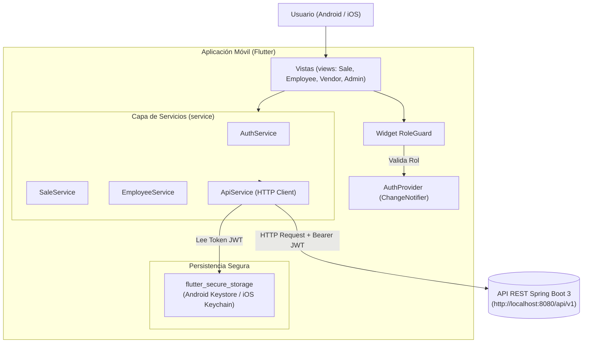

# Importaciones D&G - Aplicación Móvil

Aplicación móvil multiplataforma desarrollada con **Flutter** y **Dart** para la gestión operativa en campo de ventas, compras, catálogo de productos y supervisión de personal. Constituye el cliente móvil del ecosistema empresarial de Importaciones D&G, conectando con la API RESTful de Spring Boot 3 y brindando interfaces fluidas con control de acceso por roles (`ADMINISTRADOR`, `VENDEDOR`, `CLIENTE`) y almacenamiento seguro de credenciales JWT.


---

## 1. Funcionalidades Principales

- **Seguridad Criptográfica en Dispositivo**: Almacenamiento seguro de tokens JWT (Access y Refresh Token) utilizando Keychain en iOS y Android Keystore mediante `flutter_secure_storage`.
- **Módulo de Ventas en Campo**: Registro, edición y consulta de órdenes de venta con selección de clientes, detalle de productos y cálculo automático de montos.
- **Consulta y Supervisión de Empleados**: Listado de colaboradores, visualización de roles, estados y datos de contacto institucional.
- **Catálogo de Productos en Tiempo Real**: Exploración de inventario multisede, fichas técnicas de producto y control de existencias.
- **Dashboards Diferenciados por Rol**: Vistas optimizadas para Administradores (`AdminDashboardPage`), Vendedores (`VendorDashboardPage`) y Clientes (`ClientDashboardPage`).
- **Control de Navegación Reactivo**: Protección de vistas y elementos de interfaz mediante el componente `RoleGuard`.

---

## 2. Stack Tecnológico

| Tecnología / Paquete | Rol en el Proyecto |
| :--- | :--- |
| **Flutter SDK** | Framework UI multiplataforma para compilación nativa en Android e iOS. |
| **Dart 3.7** | Lenguaje de programación fuertemente tipado con soporte asíncrono (`Future`, `async/await`). |
| **Provider (v6.1.1)** | Gestión de estado reactivo y desacoplamiento de lógica de negocio mediante `ChangeNotifier`. |
| **flutter_secure_storage (v9.0.0)** | Cifrado y persistencia segura de tokens de autenticación en hardware seguro. |
| **http (v0.13.6)** | Cliente HTTP para consumo de endpoints REST con configuración de cabeceras. |
| **shared_preferences (v2.2.2)** | Persistencia local ligera para configuraciones de interfaz y sesión básica. |
| **intl (v0.18.0)** | Formateo internacional de monedas, fechas y localización numérica. |
| **Cupertino & Material Icons** | Iconografía y componentes de diseño visual. |

---

## 3. Arquitectura Móvil

La solución implementa una **Arquitectura en Capas Reactiva (Layered / MVVM Pattern)**:

- **Capa de Vistas (`lib/views/`)**: Widgets de pantalla organizados por módulos y roles (`auth`, `admin`, `vendor`, `client`, `sale`, `product`, `office`).
- **Capa de Widgets Reutilizables (`lib/widgets/`)**: Componentes visuales genéricos y el guardián de permisos `RoleGuard`.
- **Capa de Estado / Providers (`lib/providers/`)**: Centraliza el ciclo de vida de la autenticación (`AuthProvider`) y notifica cambios a la interfaz mediante `notifyListeners()`.
- **Capa de Servicios de Red (`lib/service/`)**: Encapsula las llamadas HTTP a la API REST, inyección del token Bearer y parseo de respuestas.
- **Capa de Modelos de Dominio (`lib/models/`)**: Entidades con constructores `fromJson()` y métodos `toJson()` para serialización estricta.
- **Capa de Configuración (`lib/config/`)**: Centralización de URLs de la API (`api_config.dart`) y diseño temático (`theme_config.dart`).



---

## 4. Estructura del Proyecto

```text
lib/
├── config/                  # Constantes de conexión y configuración temática
│   ├── api_config.dart      # URLs base y mapeo de endpoints REST
│   └── theme_config.dart    # Colores corporativos, tipografía y estilos globales
├── models/                  # Clases de dominio y serialización JSON
│   ├── auth_models.dart     # LoginRequest, LoginResponse, TokenData
│   ├── employee.dart        # Modelo de colaborador y rol
│   ├── sale.dart            # Modelo de venta y detalle de ítems
│   ├── product.dart         # Modelo de catálogo y existencias
│   └── user.dart            # Modelo de usuario autenticado
├── providers/               # Manejadores de estado reactivo
│   └── auth_provider.dart   # Estado de sesión y control de usuario activo
├── service/                 # Servicios de comunicación con el backend Spring Boot
│   ├── api_service.dart     # Cliente HTTP base con manejo de encabezados
│   ├── auth_service.dart    # Login, logout y refresh token
│   ├── employee_service.dart# Consumo de endpoints de empleados
│   ├── sale_service.dart    # Emisión y listado de ventas
│   └── product_service.dart # Consulta de productos
├── utils/                   # Utilidades de validación y formateo
│   └── validation_utils.dart# Validadores de formularios (DNI, email, contraseñas)
├── views/                   # Pantallas divididas por módulos y roles
│   ├── admin/               # Dashboards y vistas administrativas
│   ├── auth/                # Login y registro de usuarios
│   ├── client/              # Vistas para clientes y consulta de compras
│   ├── employee/            # Pantallas de gestión de personal
│   ├── sale/                # Listado y detalle de ventas
│   └── vendor/              # Panel del vendedor y creación de órdenes
├── widgets/                 # Componentes compartidos y controles de acceso
│   ├── common_widgets.dart  # Botones, campos de texto y loaders personalizados
│   └── role_guard.dart      # Widget de restricción condicional por rol
└── main.dart                # Inicialización de Flutter, providers y rutas
```

---

## 5. Seguridad y Gestión de Sesión

1. **Persistencia Criptográfica**:
   Los tokens JWT no se guardan en texto plano; se utiliza `FlutterSecureStorage` que delega en **Android Keystore** y **Apple Keychain**, protegiendo los secretos contra ataques de extracción física o volcados de memoria.
2. **Inyección de Encabezados**:
   `ApiService` recupera el token del almacenamiento seguro antes de despachar cada solicitud e inyecta:
   ```text
   Authorization: Bearer <jwt_token>
   ```
3. **Control de Flujo por Roles**:
   El widget `RoleGuard` evalúa el rol del usuario contenido en el token decodificado y restringe componentes o redirige a la pantalla adecuada según sus privilegios.

---

## 6. Integración con la API Backend

La aplicación móvil consume los endpoints expuestos por la API Spring Boot de **Importaciones D&G**:

| Servicio Móvil | Endpoint Backend Consumido | Descripción |
| :--- | :--- | :--- |
| `AuthService` | `POST /api/v1/auth/login` | Autenticación y obtención de credenciales. |
| `AuthService` | `POST /api/v1/auth/refresh` | Renovación transparente de access token expirado. |
| `SaleService` | `POST /api/v1/sale/create` | Registro de venta realizada en campo. |
| `SaleService` | `GET /api/v1/sale/list` | Consulta histórica de comprobantes de venta. |
| `EmployeeService`| `GET /api/v1/employee/listEmployee` | Consulta de personal activo. |
| `ProductService` | `GET /api/v1/products` | Consulta de catálogo y stock disponible. |

---

## 7. Cómo Ejecutar Localmente

### Requisitos Previos
- **Flutter SDK**: v3.19 o superior (probado con soporte Dart 3.7).
- **Android Studio** con SDK de Android y emulador configurado (o dispositivo físico con depuración USB activada).
- Backend de **Importaciones D&G API** en ejecución en puerto `8080`.

### Pasos de Instalación

1. **Clonar el repositorio:**
   ```bash
   git clone https://github.com/LorenzoCampos03/importaciones-dg-mobile.git
   cd importaciones-dg-mobile
   ```

2. **Descargar dependencias de Flutter:**
   ```bash
   flutter pub get
   ```

3. **Configurar la URL del backend:**
   En [lib/config/api_config.dart](lib/config/api_config.dart), ajustar `baseUrl` según el entorno de ejecución:
   - **Emulador de Android Studio**:
     ```dart
     static const String baseUrl = 'http://10.0.2.2:8080';
     ```
   - **Dispositivo físico conectado por WiFi**:
     ```dart
     static const String baseUrl = 'http://TU_IP_LOCAL:8080'; // Ej: http://192.168.1.50:8080
     ```
   - **Flutter Web / Desktop**:
     ```dart
     static const String baseUrl = 'http://localhost:8080';
     ```

4. **Ejecutar la aplicación:**
   ```bash
   flutter run
   ```

---

## 8. Pruebas Automatizadas

```bash
# Ejecutar suite de pruebas unitarias y de widgets
flutter test
```

---

## 9. CI/CD

- **Estado actual**: Sin pipeline de integración continua configurado en el repositorio (roadmap: generación automática de APK/AAB con GitHub Actions).

---

## 10. Rol y Aportes en el Proyecto

- **Modalidad**: Proyecto colaborativo en equipo (2 desarrolladores móviles/backend).
- **Módulos de responsabilidad directa (Lorenzo Campos)**:
  - **Módulo de Ventas**: Desarrollo de las pantallas de gestión de ventas (`sale_list_page.dart`, `sale_detail_page.dart`, `vendor_sales_page.dart`, `vendor_sale_create_edit_page.dart`), integrando validaciones dinámicas y cálculo de totales.
  - **Módulo de Empleados**: Implementación de la vista de colaboradores (`employee_list.dart`), modelo de datos `employee.dart` y consumo del endpoint de personal.
  - **Integración de Servicios**: Serialización y deserialización de modelos JSON (`fromJson` / `toJson`), tipado en Dart y consumo HTTP asíncrono con manejo de errores de red.
- **Desarrollo en conjunto**:
  - Arquitectura reactiva basada en Provider y control de navegación con `RoleGuard`.
  - Configuración de `flutter_secure_storage` para la protección de tokens en el dispositivo.
  - Estandarización visual con `ThemeConfig` y diseño responsivo para diferentes densidades de pantalla.

---

## 11. Roadmap / Posibles Mejoras

1. **Soporte Offline-First**: Implementar persistencia local con **Hive** o **Isar** para permitir registrar ventas sin conexión y sincronizarlas automáticamente al recuperar conectividad.
2. **Notificaciones Push**: Integrar **Firebase Cloud Messaging (FCM)** para alertar sobre nuevas órdenes de venta o cambios de inventario en tiempo real.
3. **Pipeline CI/CD**: Automatizar el linting (`flutter analyze`), pruebas unitarias y empaquetado de APK con GitHub Actions.

---

## 12. Contacto

- **Desarrollador**: Lorenzo Campos
- **LinkedIn**: [linkedin.com/in/lorenzo-campos](https://www.linkedin.com/in/lorenzo-campos)
- **Correo Electrónico**: [lorenzo.campos.p@vallegrande.edu.pe](mailto:lorenzo.campos.p@vallegrande.edu.pe)
